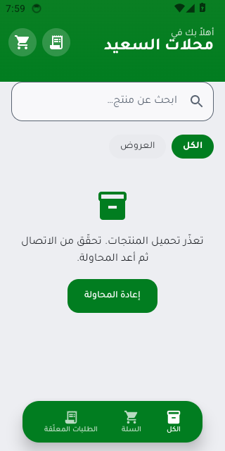
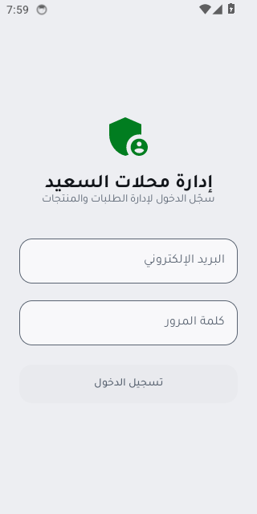

# محلات السعيد — تطبيق الزبائن وتطبيق الإدارة

> **الحالة: الشاشات منفّذة، وكل سير العمل الأربعة مخضراء عدا بوابة النشر.**
> نتائج معايير القبول الفعلية في `docs/acceptance-results.md`.
> ما زال ينقص: مشروع Supabase سحابي اختباري حقيقي، والتوقيع الإنتاجي الدائم.

## المشروع

- تطبيق الزبائن: `com.zakeleo877.saeedstore`.
- تطبيق الإدارة: `com.zakeleo877.saeedadmin`.
- وحدات Gradle: `core` مشتركة، و`customer`، و`admin` مستقلان.
- العربية وRTL وAndroid 7.0+؛ قاعدة بيانات Supabase مشتركة. يبدأ جدول المنتجات فارغًا.
- `core` يحتفظ بخط Tajawal بثلاثة أوزان وترخيصه في `docs/licenses/Tajawal-OFL.txt`، مع ثيم «محلات السعيد» الأخضر
  الفاتح (`#017D20` على صفحة `#EDEEF2`) ومكوّنات Compose قابلة لإعادة الاستخدام. كل زوج نص/خلفية
  يمرّ 4.5:1 على الأقل، و`ColorContrastTest` يعيد حساب الأزواج التي ترسمها الشاشات فعلاً.

## ما هو منفَّذ الآن

**تطبيق الزبائن**

- شبكة منتجات تكيّفية (`GridCells.Adaptive`) مع بحث نصي وشرائح فئات.
- انتقال **Shared Element** (`SharedTransitionLayout`) من بطاقة المنتج إلى شاشة التفاصيل.
- تفاصيل المنتج مع اختيار الكمية و«أضف إلى السلة»، والضغط على الصورة يفتح
  عارضًا كامل الشاشة بتكبير بالقرص وخلفية ضبابية.
- سلة محفوظة في الذاكرة مع تعديل الكمية وحذف وتراجع بالمفتاح، ويمكن حذف
  العنصر بسحبه (`SwipeToDismissBox`).
- `ModalBottomSheet` لإتمام الطلب: الاسم، الهاتف الجزائري، ملاحظات، وموقع اختياري
  يُطلب إذنه عند الضغط فقط ويشرح سبب الطلب. الموقع يُحفظ كرابط خرائط باسم
  `customerLocationUrl` وهو للتواصل فقط.
- طابور طلبات محلي دائم: يُحفظ الطلب عند تعذّر الإرسال، مع حالة لكل طلب
  (بانتظار الاتصال، جارٍ الإرسال، فشل) وإعادة المحاولة والتعديل والحذف.
- شريط «لا يوجد اتصال» مع بقاء زر الإرسال مفعّلًا، وتصفّح من الذاكرة المحلية.
- مشاركة رقم الفاتورة عبر واتساب.

**تطبيق الإدارة**

- تسجيل دخول عبر Supabase Auth، ثم `is_admin()`، ثم `claim_first_admin()` مرة واحدة فقط.
- لوحة إحصائية: طلبات جديدة، طلبات اليوم، الإجمالي، عدد المنتجات، ومبيعات «مُسلَّم».
- الطلبات: قائمة الأحدث أولًا، فلترة بالحالة، بحث، وتغيير الحالة من نافذة سفلية.
- المنتجات: إضافة وتعديل ومفتاح «متاح/مخفي» وترتيب، مع رابط صورة.
- تصدير **CSV** للمنتجات والطلبات عبر Storage Access Framework، بترميز UTF-8
  و`BOM` ليفتح بالعربية في Excel.
- على الشاشات العريضة (تابلت/قابل للطي) يستبدل `NavigationRail` الشريط السفلي،
  وتُحدَّد الفئة عبر `WindowSizeClass` من `material3-window-size-class`.
- الإعدادات: اسم المتجر ورقم الواتساب والعملة وملاحظة الفاتورة.
- إشعار محلي للطلبات الجديدة عبر `PeriodicWorkRequest` كل 15 دقيقة، بلا FCM.
- فاتورة PDF عبر `PdfDocument` و`FileProvider`.

**المشترك**

- Predictive Back مفعَّل في المانيفست (`android:enableOnBackInvokedCallback="true"`)
  ويتحكم به `PredictiveBackHandler` في العارض المخصّص للصور.
- Room يخزّن المنتجات والإعدادات، ويبقى الكاش السابق عند فشل التحديث.
- `place_order` يحسب السعر على الخادم، و`client_id` ثابت يمنع التكرار.
- Ktor مع PostgREST مباشرًا، مع تحقّق صارم من المفتاح العام.

## بنية المستودع

```text
core/                    الثيم والنماذج وKtor وRoom وNetworkMonitor واختباراتها
core/schemas/            مخطط قاعدة Room المصدَّر للإصدارات اللاحقة
customer/                تطبيق الزبائن
admin/                   تطبيق الإدارة
supabase/schema.sql      جداول وسياسات ودوال القاعدة
supabase/tests/          فحص SQL محلي بمحاكاة محدودة لخدمات Supabase
scripts/                 فحوص الحزمة والمستودع وقاعدة البيانات
docs/                    خطة المرحلة ونتائج التحقق
.github/workflows/       بناء.Release وفحص APK
```

## الأدوات والإصدارات

الإصدارات مثبتة في `gradle/libs.versions.toml` وGradle Wrapper. يتطلب المشروع JDK 17
وAndroid SDK، مع `minSdk` 24 و`targetSdk` 37. إصدار الترجمة قابل للضبط عبر
`-Psaeed.compileSdk=android-37.2` أو المتغيّر `SAEED_COMPILE_SDK`، ويفترض CI
أحدث منصة مثبّتة على الـ runner.

تستخدم القاعدة المحلية Room 3.0.3 والحزمة `androidx.room3` مع `AndroidSQLiteDriver`،
حتى لا تضاف مكتبة SQLite أصلية منفصلة. اختبارات Robolectric هنا تعمل على API 24 و28،
وليست بديلًا عن الاختبار على جهاز.

## البناء محليًا

```bash
cp local.properties.example local.properties   # SUPABASE_URL و SUPABASE_KEY
cp keystore.properties.example keystore.properties
./gradlew test lint
./gradlew :customer:assembleRelease :admin:assembleRelease
```

## البناء عبر GitHub Actions

سير `build.yml` يعمل عند كل push وعلى `workflow_dispatch`. يقرأ القيم من **GitHub Secrets** فقط
ويولّد `local.properties` و`keystore.properties` داخل الـ runner دون حفظها في المستودع:

| المتغيّر | مطلوب؟ |
|---|---|
| `SUPABASE_URL` | نعم |
| `SUPABASE_KEY` | نعم — المفتاح العام `sb_publishable_` فقط |
| `KEYSTORE_BASE64` | للإصدار الموقّع — اختياري |
| `KEYSTORE_PASSWORD` | للإصدار الموقّع — اختياري |
| `KEY_ALIAS` | للإصدار الموقّع — اختياري |
| `KEY_PASSWORD` | للإصدار الموقّع — اختياري |

عندما تكون متغيّرات التوقيع الأربعة مضبوطة، يبني الـ workflow الحزمة بمفتاح
**إنتاجي** ويُتحقّق من فتح المخزن بالاسم المحدد قبل البناء. وحين تكون غير
مضبوطة، يولّد الـ runner مفتاحًا مؤقتًا داخله فقط (ويحذفه بعد البناء) حتى
تظل فحوص الحزمة تعمل؛ في هذه الحالة تكون الحزمة **غير قابلة للتوزيع**، ويذكر
سطر التشغيل ذلك صراحةً.

الخطوات: تثبيت المنصة ← اختبار الوحدة و lint ← بناء APKين ← فحوص الحزمة ١-١٠ ←
فحوص المستودع ١١-١٣ ← فحوص SQL ← رفع الملفات كـ artifacts.

## إعداد Supabase — لا تنفّذ على بيانات حقيقية قبل النسخ الاحتياطي

1. أنشئ مشروع Supabase جديدًا ومخصصًا للمتجر، وآخر منفصلًا للاختبارات الأمنية.
2. قبل تهيئة الإدارة، عطّل **Allow new users to sign up** و**Anonymous sign-ins** من لوحة
   Authentication. تأكد أيضًا من عدم وجود أي حساب غير موثوق مسبقًا: أي مستخدم مسجّل الدخول
   قد يصبح أول مدير ما دام جدول المديرين فارغًا.
3. جرّب `supabase/schema.sql` أولًا في مشروع تجريبي. في مشروع الإنتاج الجديد فقط، نفّذه من
   SQL Editor بعد المراجعة. السكربت يستبدل **جميع سياسات RLS الموجودة على الجداول الأربعة
   التي يديرها** ويحدّث إعدادات حاوية صور المنتجات؛ فلا تشغّله على مشروع قائم دون نسخة
   احتياطية ومراجعة.
4. أنشئ حساب المدير من **Authentication → Users → Add user**. عند الدخول، يستدعي تطبيق
   الإدارة دالة المطالبة الأولى مرة واحدة. لا تترك جدول المديرين فارغًا مع حسابات أخرى.
5. يبدأ `products` فارغًا. لا تُستخدم بيانات عملاء حقيقية في الاختبارات.

### سياسة قراءة المنتجات

`products read` تسمح بـ `available or is_admin()`. لذلك يرى الزائر **المنتجات المتاحة فقط**،
بينما يرى المدير كل المنتجات بما فيها المخفية. هذا يحقق معيار القبول ٢١.

## قرار الاتصال والأمان

تستخدم الوحدة المشتركة وعمليات الزبائن المجهولة Ktor مع PostgREST مباشرة، بدل `postgrest-kt`
التي تسحب `auth-kt` إلى حزمة الزبائن. تستخدم الإدارة `supabase-kt` لطبقة المصادقة.
يُرسل مفتاح `sb_publishable_…` العام في ترويسة `apikey`، ويُضاف `Bearer` فقط عند استخدام
مفتاح `anon` القديم بصيغة JWT. يرفض الكود مفاتيح `sb_secret_` وJWT ذي دور مرتفع.

الحماية الحقيقية هي RLS على الخادم، فالقيم المضمّنة في APK قابلة للاستخراج.

## اختبارات قاعدة البيانات الحقيقية (١٤-٢٥)

السكربت `scripts/db-security-tests.sh` يعمل **على مشروع Supabase تجريبي منفصل فقط**، ويقرأ
القيم من متغيرات البيئة، و**يتوقف فورًا** إذا تطابق عنوان الاختبار مع عنوان الإنتاج أو إذا
احتوى على الكلمة `prod`. يستخدم بيانات وهمية ويحذف طلباته التجريبية.

```bash
TEST_SUPABASE_URL=... TEST_SUPABASE_KEY=... \
TEST_USER_EMAIL=... TEST_USER_PASSWORD=... \
bash scripts/db-security-tests.sh
```

## لقطات الشاشة من المحاكي

لقطتان حقيقيتان من تشغيل GitHub Actions `42121136873`، بعد تثبيت الحزمتين
وتشغيل الشاشة الرئيسية لكل تطبيق على محاكي `android-34/x86_64`:

| تطبيق الزبائن | تطبيق الإدارة |
|---|---|
|  |  |

تطبيق الزبائن يعرض العنوان «محلات السعيد» وحقل البحث وحالة الخطأ مع زر
«إعادة المحاولة» (لأن البناء يستخدم عنوانًا وهميًا فلا خادم خلفه — وهذا يثبت
مسار انقطاع الشبكة). وتطبيق الإدارة يعرض شاشة الدخول بحقلين وزر معطّل لأن
الحقول فارغة. اللقطتان منشورتان أيضًا على الفرع `ci-emulator` تحت
`artifacts/screenshots/`.

## ما لم يُتحقق منه بعد

- **لا يوجد اختبار على مشروع Supabase سحابي حقيقي.** فحوص PGlite محلية مع محاكاة Auth وREST وStorage.
- **لا يوجد FCM.** الإشعار محلي فقط عبر WorkManager، وقد يتأخر 15 دقيقة أو أكثر.
- **الخصم والتقييم حقول اختيارية جديدة تحتاج تطبيق `schema.sql` على المشروع الحقيقي.**
  حتى ذلك الحين لا تظهر شارة خصم ولا نجوم، لأن الواجهة لا تعرض شيئاً بلا بيانات.
- **اختيار صورة المنتج من المعرض غير مُتحقَّق منه على جهاز.** المسار مبني كاملاً
  (`ProductImagePicker` يختار عبر Photo Picker، يضغط WebP بحجم أقصى 1024px، يرفع إلى
  الدلو، ويربط الرابط بالمنتج)، لكنه لم يُشغَّل على هاتف ولا داخل Gradle هنا.

## الفحوص المنفّذة

| سير العمل | آخر تشغيل | النتيجة | الرابط |
|---|---|---|---|
| `Build and verify` | **42407481242** | **أخضر** — كل الخطوات | <https://github.com/zakeleo877/ARENA.PROJECT/actions/runs/42407481242> |
| `Core and schema checks` | **42407486558** | **أخضر** | <https://github.com/zakeleo877/ARENA.PROJECT/actions/runs/42407486558> |
| `Database security checks` | **42407481244** | **أخضر** | <https://github.com/zakeleo877/ARENA.PROJECT/actions/runs/42407481244> |
| `Verify the interface on an emulator` | **42407481317** | **أخضر** — التطبيقان عملا على محاكي أندرويد ولُقطت شاشتاهما في الثيم الأخضر | <https://github.com/zakeleo877/ARENA.PROJECT/actions/runs/42407481317> |
| `Release gate` | — | **أحمر كما يجب** — أسرار توقيع الإنتاج غير مضبوطة | — |

- `./gradlew test lint` نجح.
- `./gradlew :customer:assembleRelease :admin:assembleRelease` نجح (`BUILD SUCCESSFUL`).
- فحوص الحزمة ١-١٠ نجحت للتطبيقين: `resources.arsc` غير مضغوط، المحاذاة، التوقيع v2،
  الهوية، عدم قابلية التصحيح، الصلاحيات، عزل الأكواد، والحجم (853 KiB و989 KiB).
- فحوص المستودع ١١-١٣ نجحت.
- `npm ci && npm test`: **36 فحص SQL** نجحت، منها أن الزائر يرى المتاح فقط، وأن الخصم
  الأعلى من السعر والتقييم فوق ٥ مرفوضان في القاعدة.
- `npm run test:acceptance`: **38 فحصاً** على قاعدة بيانات معزولة مبنية من
  `supabase/schema.sql`، تشمل سياسات RLS وتسجيل الدخول ولوحة الإدارة.
- `./gradlew test`: **10 ملفات اختبار** تشمل اختبارات واجهة Compose على الـ JVM
  واختبارات تكامل تقود `CatalogApi` و`AuthManager` و`OrderRepository` الحقيقية
  ضد قاعدة البيانات المعزولة.
- **محاكي Android في CI**: التشغيل `42121136873` ثبّت الحزمتين على محاكي
  `android-34`، وشغّل الشاشة الرئيسية لكل منهما (`LaunchState: COLD`)،
  وتأكد أن العملية حية وأن لا يوجد استثناء قاتل، والتقط لقطة شاشة لكل
  تطبيق (320x640). اللقطات منشورة على الفرع `ci-emulator` تحت
  `artifacts/screenshots/`، والتقرير الكامل في `emulator-diagnostics.md`
  على الفرع نفسه.
- فحص ثابت محلي (`scripts/verify-kotlin-refs.py`) يلتقط الاستيرادات الناقصة
  وأسماء المعاملات الخاطئة قبل البناء بخمس دقائق.

التفاصيل الكاملة في `docs/acceptance-results.md`.
